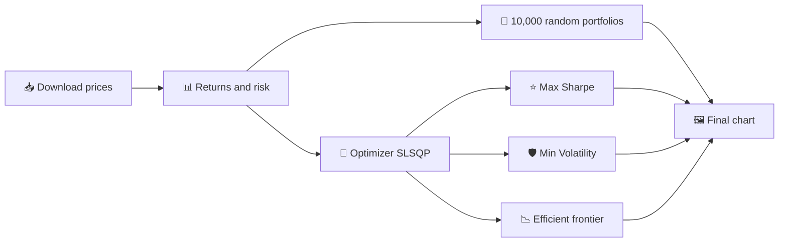

<!-- ===================== HEADER ===================== -->
<div align="center">


<a href="https://github.com/PrabhatDev28/markowitz-portfolio-optimization">
  
</a>

<br/>


<br/>

<a href="https://colab.research.google.com/github/PrabhatDev28/markowitz-portfolio-optimization/blob/main/Markowitz_Portfolio_Optimization.ipynb">
  
</a>

</div>

---

## 📑 Contents
[Features](#-features) · [Demo](#-demo) · [How it works](#-how-it-works) · [Formulas](#-the-math-in-simple-words) · [Run it](#-run-it-in-2-minutes) · [Read the results](#-how-to-read-the-results) · [Ideas](#-ideas-to-try-next)

---

## ✨ Features

| | Feature | What it does |
|---|---|---|
| 🎲 | **Random portfolios** | Tries 10,000 random mixes of stocks to show every possible risk and return outcome |
| ⭐ | **Max Sharpe portfolio** | Finds the mix with the best return for each unit of risk |
| 🛡️ | **Min Volatility portfolio** | Finds the mix with the lowest overall risk |
| 📉 | **Efficient frontier** | Draws the curve of the best possible portfolios |
| ⚖️ | **Equal-weight benchmark** | Compares everything against a simple "split equally" portfolio |
| 🔒 | **Weight cap** | Limit how much money can go into a single stock (for example, max 40%) |
| 🇮🇳 | **Any Yahoo Finance stock** | Works with Indian stocks (`.NS`) and global stocks |

**Tech:** Python · NumPy · pandas · SciPy · Matplotlib · yfinance

---

## 📈 Demo

<div align="center">


*Left: 10,000 random portfolios (colored by Sharpe ratio) with the efficient frontier. Right: how each strategy splits the money across six NSE stocks.*

</div>

| Symbol | Meaning |
|---|---|
| ⭐ Gold star | Max Sharpe portfolio (best risk-adjusted return) |
| 🔴 Red diamond | Minimum volatility portfolio (lowest risk) |
| ⚫ Black dots | Each stock on its own |
| `- - -` Red dashed line | Efficient frontier |

---

## 🧠 How it works



1. **Download** 5 years of daily prices for your stocks using `yfinance`.
2. Calculate each stock's **average yearly return** and how the stocks **move together** (covariance).
3. Generate **10,000 random portfolios** to see the full range of outcomes.
4. Use `scipy.optimize` to find the **exact best weights** for Max Sharpe and Min Volatility.
5. For each target return, find the **lowest possible risk**. Together these points form the efficient frontier.
6. **Plot** the results and compare the strategies.

<details>
<summary><b>🤔 What is the efficient frontier?</b></summary>

<br/>

For every level of risk, there is a best possible return. For every level of return, there is a lowest possible risk. Joining all these "best" portfolios gives a curve called the **efficient frontier**. Any portfolio below the curve is a worse deal, because you could earn more for the same risk by moving up to the curve.

</details>

<details>
<summary><b>🤔 Why does mixing stocks reduce risk?</b></summary>

<br/>

When one stock falls, another may rise or fall less. Holding stocks that don't move together smooths out the ups and downs of the whole portfolio. This is **diversification**, and it is the main idea behind Markowitz's work (Nobel Prize, 1990).

</details>

### ⚙️ Settings you can change

| Setting | Default | What it controls |
|---|---|---|
| `TICKERS` | 6 NSE stocks | The stocks to include |
| `HISTORY_PERIOD` | `5y` | How much past data to use |
| `RISK_FREE_RATE` | `0.07` | Return you could earn with no risk (about 7% for Indian govt bonds) |
| `NUM_PORTFOLIOS` | `10000` | How many random portfolios to try |
| `MAX_WEIGHT` | `1.0` | Maximum share for one stock (`0.4` means 40%) |

---

## 🧮 The math in simple words

| Idea | Formula | In plain English |
|---|---|---|
| Portfolio return | $R_p = \sum w_i R_i$ | Add up each stock's return times its share |
| Portfolio risk | $\sigma_p = \sqrt{w^T \Sigma w}$ | Combine each stock's risk and how the stocks move together |
| Sharpe ratio | $\frac{R_p - R_f}{\sigma_p}$ | Extra return you earn for every unit of risk |

---

## 🚀 Run it in 2 minutes

**Option 1: Google Colab (no installation)**

1. Click the **Open in Colab** button above.
2. Choose **Runtime → Run all**.
3. Edit the **Settings** cell to try your own stocks, then run all again.

**Option 2: Your own computer**

```bash
git clone https://github.com/PrabhatDev28/markowitz-portfolio-optimization.git
cd markowitz-portfolio-optimization
pip install -r requirements.txt
python markowitz_optimizer.py
```

> 💡 Indian stocks use `.NS` at the end, for example `TCS.NS` or `RELIANCE.NS`.

---

## 📊 How to read the results

| Output | Meaning |
|---|---|
| **Expected return** | Average yearly return, based on past data |
| **Volatility** | How much the portfolio value jumps around in a year (risk) |
| **Sharpe ratio** | Extra return per unit of risk. Higher is better |
| **Max Sharpe weights** | The mix with the best risk-adjusted return |
| **Min Volatility weights** | The mix with the lowest overall risk |

---

## 📂 Project structure

```
├── Markowitz_Portfolio_Optimization.ipynb   # Google Colab version
├── markowitz_optimizer.py                   # Python script version
├── requirements.txt
├── portfolio_results.png
├── LICENSE
└── README.md
```

---

## 💡 Ideas to try next

- [ ] Add a correlation heatmap of the stocks
- [ ] Compare the optimized portfolio with the Nifty 50 index
- [ ] Back-test: optimize on old data and check how it performed on new data
- [ ] Add a "target return" input to get the lowest-risk mix for that goal
- [ ] Build a small Streamlit app where anyone can pick stocks

---

## 📝 Notes

- The optimizer uses **past** returns to plan for the **future**, which real markets don't guarantee.
- Without a weight cap, the Max Sharpe portfolio often puts most of the money in one or two stocks that did best in the past. Set `MAX_WEIGHT = 0.4` to spread the risk.
- This is a learning project and **not financial advice**.

---

<div align="center">

**Built by [Prabhat Mishra](https://github.com/PrabhatDev28)** · If this helped you, a ⭐ means a lot!


</div>
