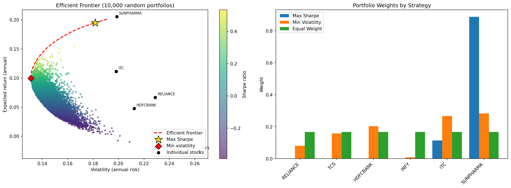

# 📊 Markowitz Portfolio Optimization

Finds the best mix of stocks using Modern Portfolio Theory: maximum return for the risk you take.

[](https://colab.research.google.com/github/PrabhatDev28/markowitz-portfolio-optimization/blob/main/Markowitz_Portfolio_Optimization.ipynb)




*Example: efficient frontier and optimal weights for six NSE-listed stocks.*

## Features

- Efficient frontier built from 10,000+ random portfolios
- Maximum Sharpe ratio portfolio (best return per unit of risk)
- Minimum volatility portfolio (lowest risk)
- Comparison against a simple equal-weight portfolio
- Optional cap on weight per stock (for example, max 40% in one stock)
- Works on any stock available on Yahoo Finance

**Tech:** Python, NumPy, pandas, SciPy, Matplotlib, yfinance

## How it works

1. Download past prices for your stocks using `yfinance`.
2. Calculate each stock's average yearly return and the covariance between stocks.
3. Generate 10,000 random portfolios to see the range of possible outcomes.
4. Use `scipy.optimize` (SLSQP) to find the weights that maximize the Sharpe ratio.
5. Use the same optimizer to find the lowest-risk portfolio.
6. Trace the efficient frontier by finding the lowest risk for each target return.
7. Plot the frontier and compare the weights of each strategy.

**Core formulas**

- Portfolio return: `Rp = Σ wᵢ · Rᵢ`
- Portfolio risk: `σp = √(wᵀ Σ w)`
- Sharpe ratio: `(Rp − Rf) / σp`

## Quick start

**Option 1: Google Colab (no installation)** Click the **Open in Colab** badge above, then choose **Runtime → Run all**.

**Option 2: Your own computer**

```bash
git clone https://github.com/PrabhatDev28/markowitz-portfolio-optimization.git
cd markowitz-portfolio-optimization
pip install -r requirements.txt
python markowitz_optimizer.py
```

Change `TICKERS`, `HISTORY_PERIOD`, `RISK_FREE_RATE`, `NUM_PORTFOLIOS` or `MAX_WEIGHT` at the top of the file to experiment. Indian stocks use `.NS`, for example `TCS.NS` or `RELIANCE.NS`.

## How to read the results

| Output | Meaning |
|---|---|
| Expected return | Average yearly return, based on past data |
| Volatility | How much the portfolio value moves around in a year (risk) |
| Sharpe ratio | Extra return earned per unit of risk. Higher is better |
| Max Sharpe weights | The mix with the best risk-adjusted return |
| Min Volatility weights | The mix with the lowest overall risk |

## Project structure

```
├── Markowitz_Portfolio_Optimization.ipynb   # Google Colab version
├── markowitz_optimizer.py                   # Python script version
├── requirements.txt
├── portfolio_results.png
└── README.md
```

## Limitations

This is a learning project. It assumes past returns and correlations continue into the future, which real markets don't guarantee. Optimizers also tend to put large weights on whichever stocks did best in the past, so use `MAX_WEIGHT` to limit that. **Not financial advice.**

## License

MIT
